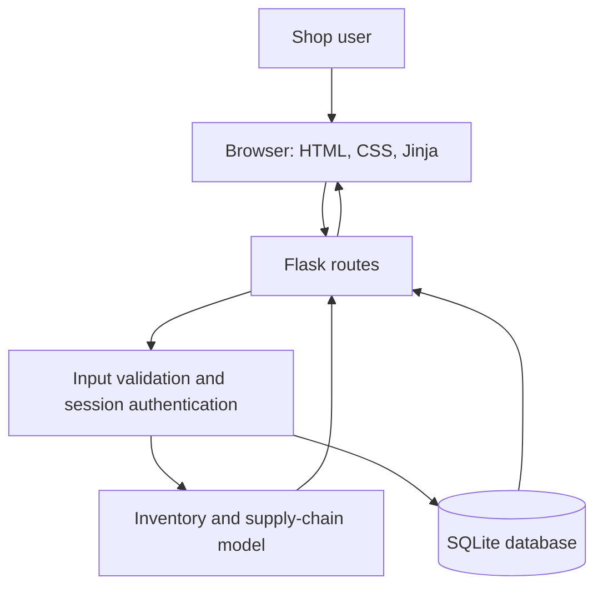
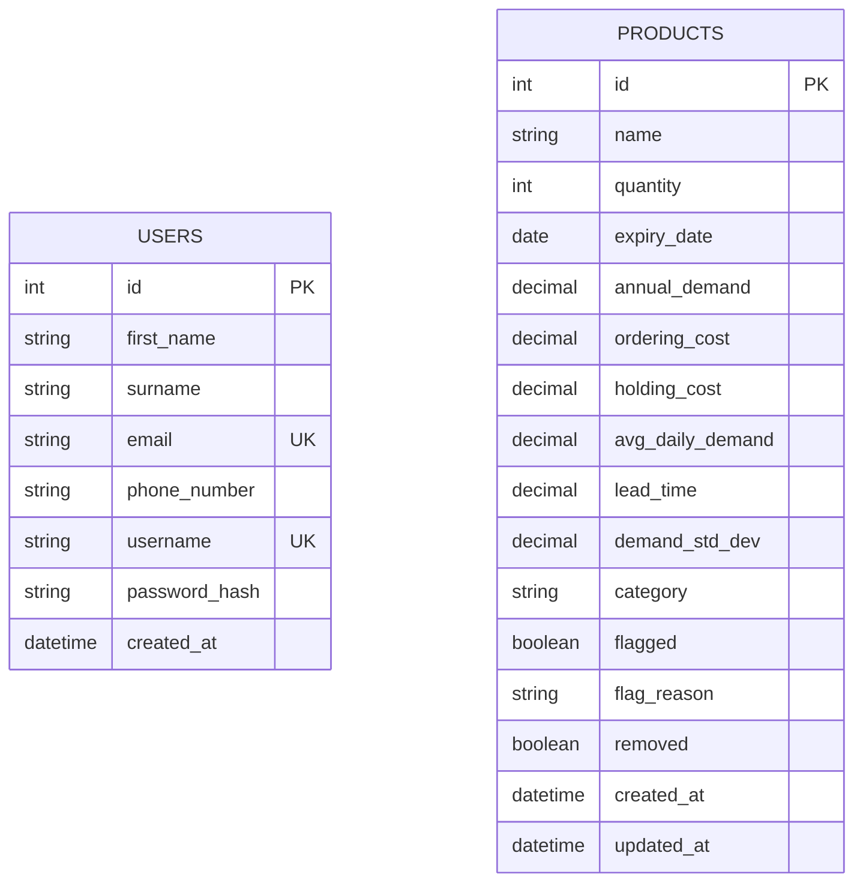

# System architecture and data model

## Architecture

## Entity relationship diagram

Users authenticate to the prototype; product records are currently shared across the application and are not yet linked to an individual user/shop. A production multi-shop version should add a `shops` table and a `shop_id` foreign key on products, with authorization checks on every query.
